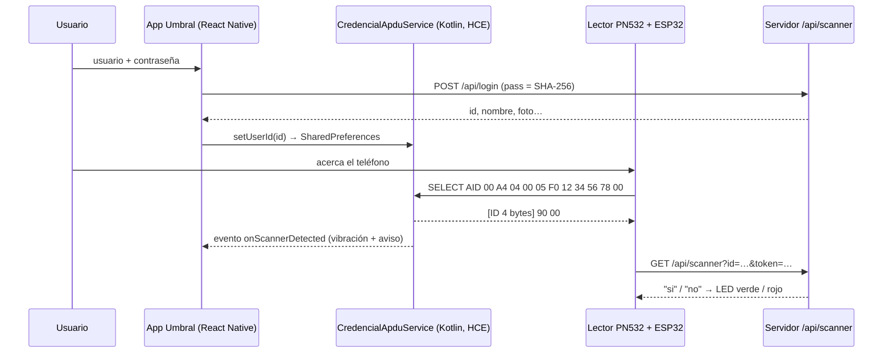

# Umbral · Credencial NFC para hospitales y centros de salud

Aplicación móvil cliente del **sistema de acceso físico con Arduino, NFC y Android** del curso de Aplicaciones Móviles (Universidad La Salle México). Desarrollada con **React Native + Expo** por el equipo **Ciberpunks**:

- Edgar Allan Espinosa Hinojosa
- Patricio Ruiz Cerdeño
- Adrián Emiliano Leyva Durante

El teléfono se comporta como una tarjeta de proximidad: al acercarlo al lector (PN532 + Arduino Nano ESP32) responde por NFC con el **número de usuario en 4 bytes** usando el protocolo **APDU**. El lector consulta al servidor y decide si concede el acceso; la app nunca muestra ni conoce ese resultado.

## Funciones

| Requisito de la práctica | Dónde está |
|---|---|
| Acceso con usuario y contraseña contra la API de la práctica 2 | `src/app/index.tsx`, `src/lib/api.ts` (`POST /login`, contraseña en SHA-256) |
| Logotipo y nombre acordes al giro (salud) | `src/components/Logo.tsx`, `assets/` |
| Cambiar imagen de perfil | Toca la foto en la credencial → `POST /setpfp` (`src/lib/api.ts`) |
| Pantalla "credencial" con foto, nombre completo y número de usuario | `src/app/credencial.tsx` |
| Enviar el número de usuario en 4 bytes por NFC/APDU | `modules/credencial-hce` (servicio `HostApduService` en Kotlin) |
| Retroalimentar que se detectó el escáner | Vibración nativa + destello, borde del gafete y aviso "Lector detectado" |
| Botón "Créditos" con integrantes, grupo, fecha y tech stack con logotipos oficiales | `src/app/creditos.tsx`, `src/data/equipo.ts` |

## Cómo funciona



### Orden de bytes (importante)

El firmware `ScannerHTTP.ino` reconstruye el ID con `memcpy(&id, userId, 4)`. El ESP32 es **little-endian**, así que el primer byte recibido es el menos significativo. Por eso la app envía el ID en little-endian:

| ID | Bytes enviados (LE) | Lo que reconstruye el Arduino |
|---|---|---|
| 25 | `19 00 00 00` | 25 ✅ |
| 25 (si se enviara big-endian) | `00 00 00 19` | 419 430 400 ❌ |

Además, el firmware trata como casos especiales las respuestas cuyo **cuarto byte** sea `FE` o `DE` (las credenciales de prueba `DEADCAFE`/`DEADC0DE` de la app de ejemplo). En little-endian el cuarto byte es el más significativo, que vale `00` para cualquier ID menor a 16 777 216, así que no hay colisión.

Si el profesor cambia el firmware, el orden se puede cambiar sin recompilar: **mantén presionado el número de usuario** para abrir el panel de diagnóstico y elige `LE` o `BE`. El valor por omisión está en `src/lib/config.ts`.

## Requisitos

- Node.js 20 o superior
- Teléfono Android con NFC y HCE (casi todos los que tienen NFC), con el NFC encendido
- Para compilar localmente: Android Studio (SDK + JDK 17) y depuración USB activada en el teléfono

> **No funciona en Expo Go**: la credencial usa un módulo nativo propio. Expo Go sólo sirve para ver la interfaz.

## Compilar e instalar

```bash
npm install
```

**Opción A — Descargar el APK ya compilado:** cada push a `main` ejecuta el workflow `.github/workflows/build-apk.yml`, que compila la app en GitHub Actions y publica el `.apk` en la sección **Releases** del repositorio.

**Opción B — APK en la nube con EAS (no requiere Android Studio):**

```bash
npx eas-cli@latest login
npx eas-cli@latest build -p android --profile preview
```

Al terminar, EAS da un enlace/QR para descargar el `.apk` e instalarlo en el teléfono.

**Opción C — Compilación local con el teléfono conectado por USB:**

```bash
npx expo run:android --variant release
```

Para desarrollo con recarga en caliente: `npx expo run:android` (build de depuración).

## Antes de la demostración

1. **Desinstala la app de ejemplo del profesor** si está en el mismo teléfono: registra el mismo AID (`F012345678`) y Android podría enrutarle el lector a ella. Si `Umbral` detecta el conflicto, lo avisa en la credencial.
2. NFC encendido y teléfono **desbloqueado** (`requireDeviceUnlock="true"`).
3. Inicia sesión con cada integrante y verifica en el panel web `https://monsterballgo.com/app-access/panel` el intento de acceso.

## Estructura

```
src/
  app/                 Pantallas (Expo Router): index (login), credencial, creditos
  components/          Logo, botones, ondas NFC, logotipos de tecnologías
  lib/                 API, sesión, almacenamiento seguro, puente con el módulo NFC
  data/                Créditos y logotipos (generados de simple-icons)
modules/credencial-hce/
  android/.../CredencialApduService.kt   Responde los comandos APDU del lector
  android/.../CredencialHceModule.kt     Expone el módulo a JavaScript y emite eventos
  android/.../CredencialStore.kt         Guarda el ID y lo convierte a 4 bytes
  android/src/main/res/xml/credencial_apduservice.xml   Registro del AID
scripts/generar-logos.js                 Regenera src/data/logos.generated.ts
```

## Referencias

- Repositorio del sistema de acceso: https://github.com/fmg2099/NFCAccesoFisico
- Android Host-based card emulation: https://developer.android.com/develop/connectivity/nfc/hce
- Expo Modules API: https://docs.expo.dev/modules/overview/
